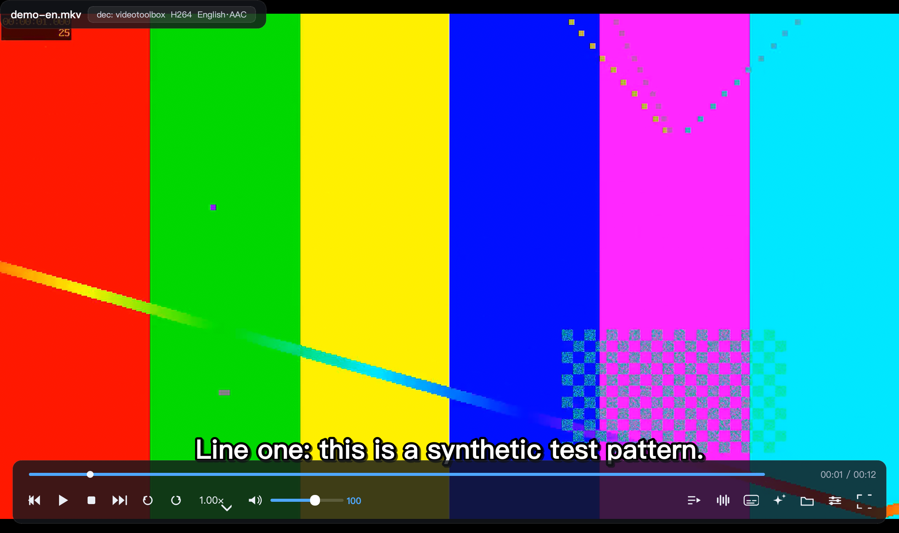
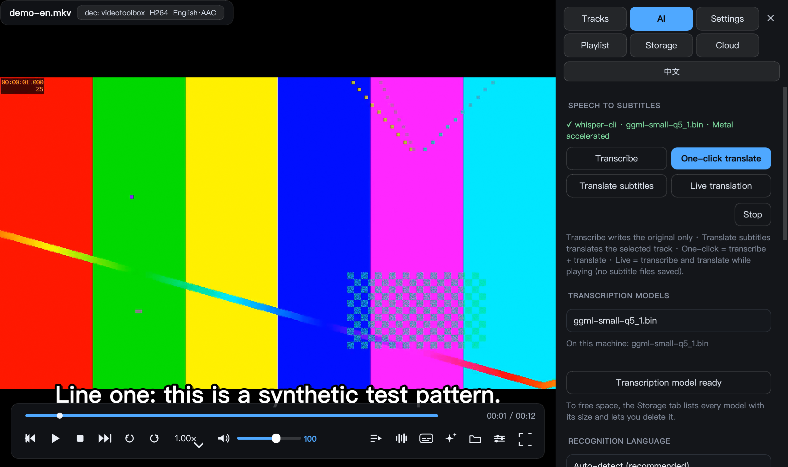
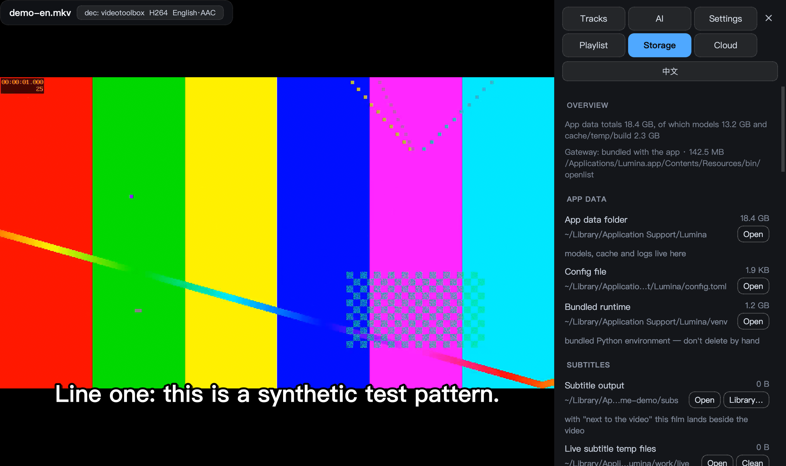
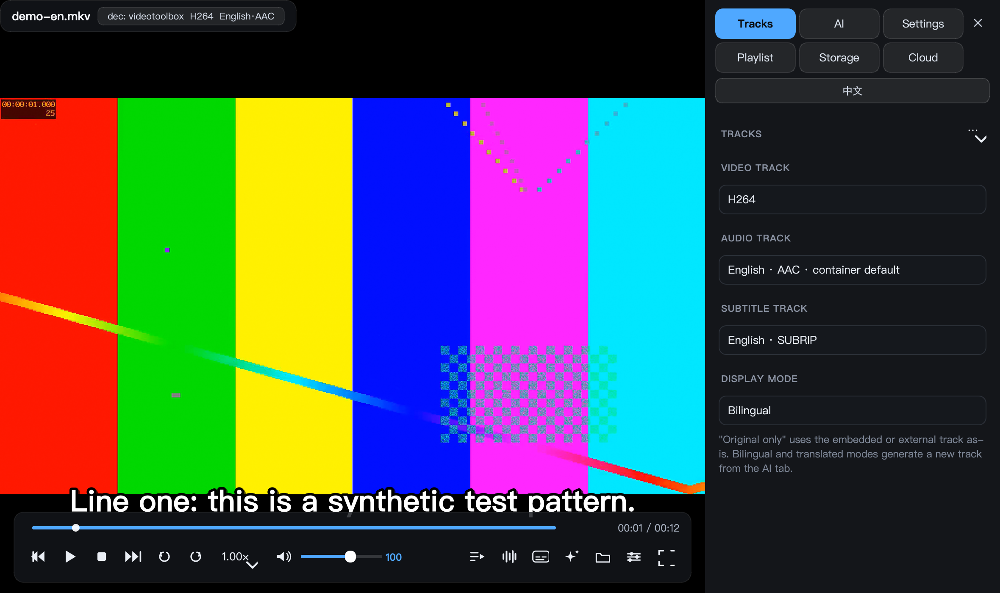
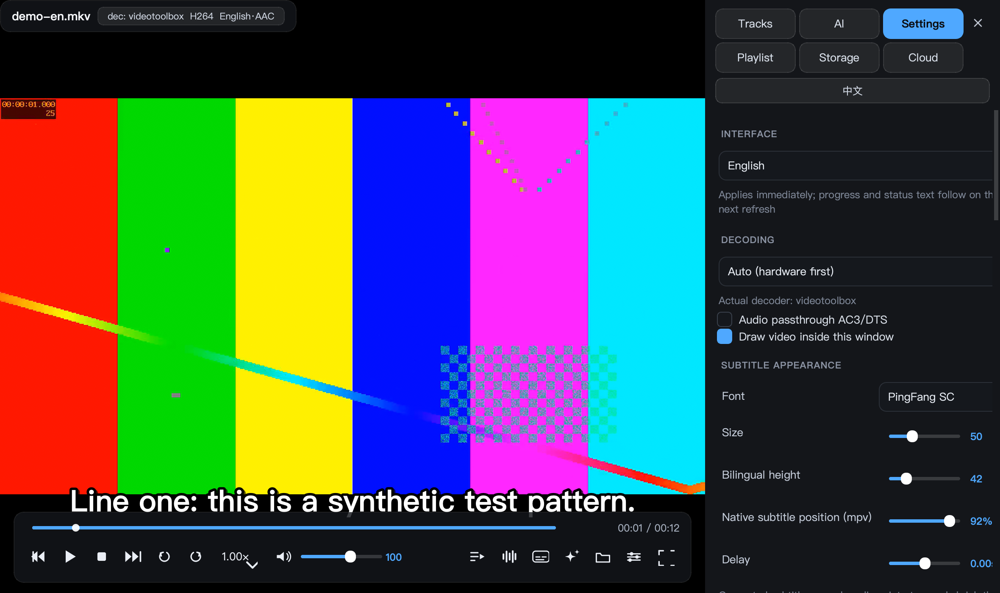
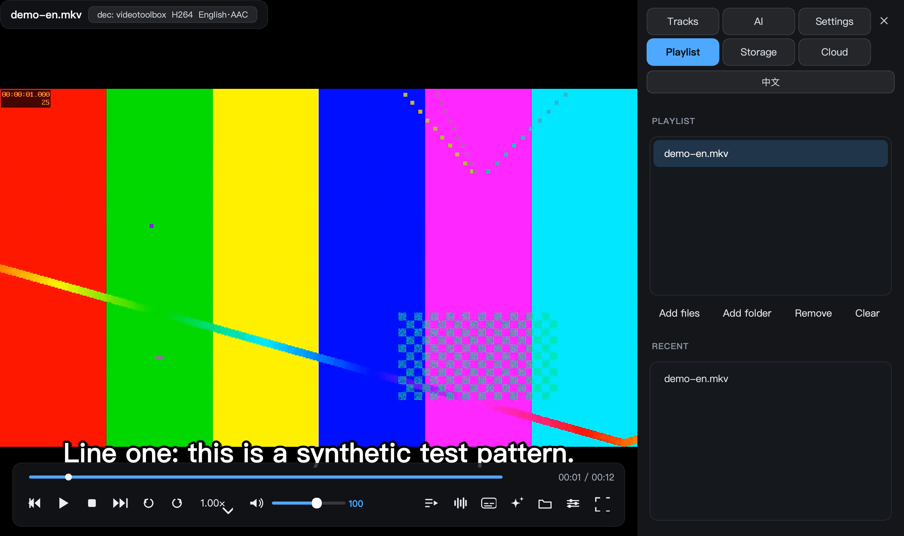
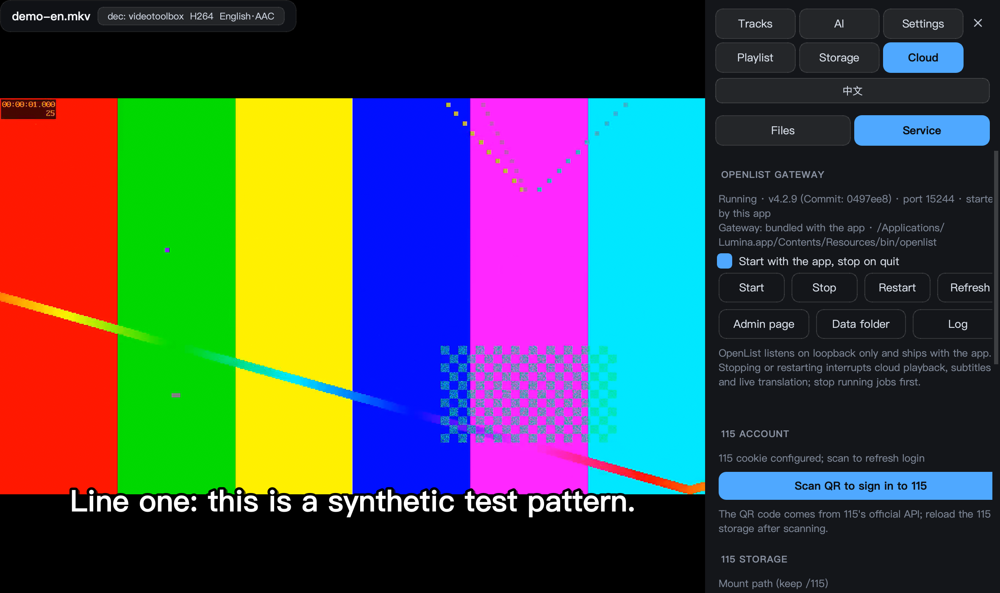

# Lumina Player

[中文](README.md) · **English**

A local video player for macOS. Open a file and it plays — audio and subtitle tracks are picked for you, a film with no subtitles gets transcribed and translated on the spot, and movies you keep on the 115 cloud drive stream directly.

<div align="center">


</div>



> The interface ships in **English and Chinese**: pick the language in Settings, or with the one-click switch in the sidebar / on the start screen (it shows the *other* language, so you can find it even if you can't read the current one). Screenshots below are the English UI.

---

## Why this exists

The requirements were specific, and existing players only covered part of them:

1. **Never touch tracks again** — audio and subtitle tracks are chosen from my language preference, once, and stay chosen for every film afterwards.
2. **Films without subtitles should still be watchable** — transcribe the speech, translate it, ideally while playing.
3. **Stream straight from the cloud drive** — no pre-download, no mounted volume, no cache files left on disk.
4. **Fixing problems shouldn't need a terminal** — the app checks its own environment, installs what's missing, and shows every path it writes to so I can clean them up myself.

Lumina is not an mpv skin: libmpv renders **in-process** inside its own `QOpenGLWidget`, wrapped in an interface I actually like using.

---

## Interface

| AI subtitles | Storage & cleanup |
|---|---|
|  |  |

| Tracks & language | Playback settings | Playlist |
|---|---|---|
|  |  |  |

The sidebar has six tabs: Tracks / AI / Settings / Playlist / Storage / Cloud. Low-frequency actions live in dropdowns rather than filling the screen with buttons.
All screenshots come from `scripts/make_shots.py`, which renders a synthetic test clip with ffmpeg — no real footage appears in them.

---

## Playback

- **Genuinely single-window**: libmpv draws through ctypes into its own `QOpenGLWidget` — not "spawn an mpv process and re-parent its surface". Hardware decoding still uses VideoToolbox (the title bar shows `解：videotoolbox`), so the looks aren't bought with performance.
- **Decoder choice**: `auto-safe` (hardware first, fall back to software on failure) / hardware only / software only.
- **Formats handled by FFmpeg**: 60+ container extensions — mkv / mp4 / m2ts / rmvb / flv / webm / mxf / vob — plus audio such as mp3 / flac / ape / dsf / mka / tta.
- **Finder integration**: double-click, "Open With", drag onto the Dock icon, or pass files/directories on the command line.
- **Control bar**: frame step, ±10s / ±30s / ±60s, 0.25× speed steps, chapter bar, playlist, resume-where-you-left-off, a dedicated stop button.

## Subtitles and language

- **Language preference**: tracks are selected by BCP-47 tag order (default 中文 → English), set once and applied forever. **A track you picked manually always wins** — the policy never steals it back.
- **Three display modes**: original / bilingual / translated (`Z`). Bilingual is a single generated ASS file — original line above, translation below, long lines wrapped and slightly scaled so nothing leaves the frame.
- **Everything styleable**: font, size, outline, shadow, margins, delay, bold, and whether AI subtitles sit above or below the original.
- **Native subtitles**: srt / ass / ssa / vtt / sub / idx / lrc read directly; external subtitle files can be attached manually.

## AI subtitles: transcription + translation

- **Whole-file transcription**: whisper.cpp; long films are auto-split into 10-minute segments with 3s overlap, sentences stream out as they're recognised. If an intro song yields 0 segments, it retries from +30s.
- **Live transcription**: a sliding window while playing (20s window, 4s overlap by default), with a look-ahead buffer ahead of the play head so subtitles stay slightly in front of the picture.
- **Channel handling**: 5.1 / 7.1 uses the centre channel only — down-mixing the whole track lets background music drown speech and whisper falls into a repetition loop.
- **Language isn't a one-shot guess**: speech detection samples the intro and other positions to correct the declared track tag (Japanese audio mislabelled `eng` is common), and each film remembers its own result. If you change the language, stale transcriptions in a different language are redone instead of "translating" an English transcript of Japanese audio.
- **Four translation backends**: OpenAI-compatible endpoint (any base_url) / DeepL / **local llama.cpp + GGUF (fully offline)** / Argos.
- **Model roles**: live translation uses a small model for speed (0.5B–3B); one-click / whole-file uses a big one at its own pace (7B / Qwen3.5-9B / 14B). Selecting a not-yet-downloaded model in the dropdown turns the button into a download, with resume and mirror fallback.
- **Context aware**: optionally feed the previous N source/target sentences to the model so names and pronouns stop drifting.
- **No double spending**: translated sentences are cached on disk; rewatching a film reuses them.
- **Outputs in their place**: one folder per film with `<name>.original.srt` / `<name>.<Lang>.translated.srt` / `<name>.bilingual.ass` (Chinese UI writes `<片名>.原文.srt` / `<片名>.<语言>译文.srt` / `<片名>.双语.ass`). Reattached automatically next time you open that film, and both naming schemes are recognised, so old files keep working.

## Cloud-drive playback (OpenList)



[115 (115.com)](https://115.com) is a Chinese cloud drive; this section is about streaming from your own account without downloading first.

- **The gateway is compiled into the app**: OpenList is built from source by `scripts/build_openlist.sh` and lands at `Lumina.app/Contents/Resources/bin/openlist`, listening only on `127.0.0.1`. **It starts when the app starts and shuts down when the app quits**; manual start/stop is also available — you install nothing extra.
- **Not just 115**: OpenList supports 90+ storages (Aliyun Drive, Quark, 123, S3, WebDAV, OneDrive, Google Drive…). The Cloud tab lists **every mount** from the gateway root — browse and double-click to play any of them; **Add storage…** creates a new mount from the driver's own fields, and OAuth drives sign in through **Web admin** (OpenList's bundled UI).
- **The playback URL never changes**: Lumina only talks to loopback WebDAV, and the gateway handles refreshing direct links. The admin token is read fresh each time and never written into config.
- **Single-stream Range proxy**: a second concurrent stream of the same file gets rejected upstream, so live translation from the cloud opens exactly **one** sequential connection, keeps bytes in an in-memory block cache, and both the player and the transcriber read from that local copy. **Video is never written to disk.**
- **No self-inflicted contention**: when proxying, the player's read-ahead is capped to match the cache and converted to seconds from the bitrate — otherwise the two readers tug the single upstream stream apart and trip the throttle.
- **115's QR login happens inside the app**, not in a web admin panel.

## Transparent and maintainable

- **Self-healing environment check**: missing mpv / ffmpeg / whisper-cli are installed via Homebrew from inside the app, with visible output and a cancel button.
- **Storage ledger**: every output, download and cache entry shows its path, size and whether it can be deleted, in the Storage tab, grouped as *app data root / subtitle outputs / cache & markers / gateway & logs / build & distribution*. Each row opens in Finder. **Deletion is confined to the app's own data directory**, and every path is computed by code rather than hardcoded.
- **Models are deletable**: transcription and translation models are listed individually with sizes and "who is using this"; deletion asks for confirmation and refuses while a job runs. Deleting an in-use model switches to a replacement and updates the UI.
- **Crashes are investigable**: app log, player log and gateway log are all clickable paths; exceptions go to files (a GUI app has no console).
- **Judged, not eyeballed**: `scripts/selfcheck.py` runs 300 structural checks (hardware decoding, embedding, proxy, language detection, storage, privacy) plus six end-to-end suites.

---

## Download and install

Grab `Lumina-0.2.0-macOS-arm64.zip` (bundles the Python runtime, PySide6 and the cloud gateway) from [Releases](https://github.com/hahawsss/Lumina-Player/releases), unzip and drag `Lumina.app` into Applications.

> **On first launch use right-click → Open** (ad-hoc signed, not notarised by Apple), or:
> ```bash
> xattr -dr com.apple.quarantine /Applications/Lumina.app
> ```
> Playback also needs `mpv` and `ffmpeg` from Homebrew; if they're missing the app tells you and installs them.

### Run from source

```bash
git clone https://github.com/hahawsss/Lumina-Player.git
cd Lumina-Player && ./start.sh            # check env → build runtime → launch
./start.sh movie.mkv                      # play directly (files or directories)
./start.sh --check                        # environment check only
./run.sh movie.mkv                        # run through the uv environment
```

Double-clicking **「启动 Lumina.command」** in the repository root also works.

### Build it yourself

```bash
./scripts/build_openlist.sh   # compile the cloud gateway from source (pinned version, cached)
./scripts/make_app.sh         # local .app installed into /Applications, gateway included
./scripts/make_portable.sh    # distributable .app + zip (own Python runtime; re-extracts the zip before shipping to re-verify the code signature and that the bundled source equals the repo)
./scripts/verify_all.sh       # six suites + 300 self-checks
./scripts/make_shots.py       # regenerate the README screenshots (synthetic material only)
```

> The runtime venv must live in `~/Library/Application Support/Lumina/` and be a non-editable install: macOS TCC treats "Documents" as protected, and a GUI process launched by launchd would hang on an invisible permission prompt.

---

## Keyboard shortcuts

| Key | Action | Key | Action |
|---|---|---|---|
| `Space` / `K` | play · pause | `←` / `→` | −10s / +30s |
| `Shift+←/→` | ±60s | `Alt+←/→` | previous / next |
| `↑` / `↓` | volume | `M` | mute |
| `[` / `]` | speed ±0.25 | `Backspace` | back to 1× |
| `,` / `.` | frame step | `F` | fullscreen |
| `Z` | original → bilingual → translated | `S` / `A` | switch subtitle / audio track |
| `T` | AI subtitles | `G` | tracks |
| `I` | settings | `L` | playlist |
| `D` | cloud (115 files / gateway) | `R` | storage & cleanup |
| `Ctrl+O` | open | `Ctrl+S` | attach subtitle file |
| `⌘,` | settings | `Ctrl+H` | collapse sidebar |

---

## Where the data lives

Everything is under `~/Library/Application Support/Lumina/` — uninstalling means deleting this folder:

| Path | Contents | Cleanable |
|---|---|---|
| `config.toml` | configuration, hand-editable | keep |
| `venv/` | runtime Python environment | don't delete by hand |
| `models/whisper/` | transcription models (`ggml-*.bin`, default small ≈ 181 MB) | yes, from the UI |
| `models/llm/` | local translation models (`*.gguf`, 0.46–9 GB) | yes, from the UI |
| `subtitles/` | generated subtitles, one folder per film | delete from the subtitle library |
| `work/` | temporary audio for transcription, extracted embedded subtitles | yes |
| `work/live/` | live-translation temp subtitles, cleared on exit | yes |
| `cache/` | translation cache, transcription markers, per-film language ledger | yes (causes re-transcribe / re-translate) |
| `cloud/openlist/` | gateway data directory: **login state and mount config for every cloud drive live here** | keep (deleting means signing in again) |
| `build/` | gateway build cache (Go toolchain + source + modules) | yes (rebuild re-downloads) |
| `app.log` / `lumina.log` | app log / player log | yes |

---

## Privacy

- **No telemetry at all**: no analytics, no reporting, no update pings. Apart from the translation service and cloud drive you choose to use, the app contacts no server.
- **115 credentials stay local**: the cookie lives in `cloud/openlist/data.db`, held by the local gateway; Lumina reads the admin token fresh each time, **never writes it to config, never uploads it**.
- **API keys go only into the macOS Keychain** (or the environment variables `LUMINA_OPENAI_KEY` / `LUMINA_DEEPL_KEY`) — no plaintext in the config file.
- **Cloud video is not written to disk**: only short-lived temporary audio for transcription touches the disk and is deleted afterwards; it's visible and cleanable in the Storage tab.
- **Shipped builds pass a privacy gate**: before zipping, `make_portable.sh` strips bytecode and build paths, then byte-compares real credential values against every file in the bundle and refuses to ship on a hit.

---

## Known limitations

- **Work in progress**: 0.1.x — config keys and UI structure may still change.
- **Unsigned / not notarised**: first launch needs right-click → Open.
- **Tested only on Apple Silicon**: Intel Macs unverified; Windows / Linux are not on the roadmap.
- **You authorise the cloud drives yourself**: 115 needs a QR scan under Cloud → Service; other drives are configured with **Add storage** or through **Web admin**. Drives rate-limit requests, so live transcription of long, high-bitrate films is bandwidth-sensitive.
- **Live translation is model-size sensitive**: keep the live slot at ≤3B; leave 9B/14B for whole-file or one-click runs.
- **AI features need extra downloads**: whisper models ~75 MB–1.5 GB, local translation models ~0.46–9 GB; online translation needs your own key.

---

## License

Code is released under **GPL-3.0**; full text in [LICENSE](LICENSE).

Bundled / depended-on third-party components:

| Component | License | How it's provided |
|---|---|---|
| mpv (playback engine) | GPL-2.0+ | via Homebrew, not in the package |
| FFmpeg | LGPL/GPL (build-dependent) | via Homebrew |
| whisper.cpp | MIT | via Homebrew |
| llama.cpp | MIT | via Homebrew (optional) |
| **OpenList** (contains 115driver) | **AGPL-3.0** / MIT | **binary redistributed in the package**; tag, commit, build flags and the rebuild command are recorded in `Lumina.app/Contents/Resources/openlist-build-info.txt`, and `scripts/build_openlist.sh` in this repo is that build script |
| PySide6 / Qt | LGPL-3.0 | pip dependency, dynamically linked |
| Fonts (PingFang SC etc.) | system-provided | not redistributed |

## Disclaimer

This project is for playing audio/video **you legally own**. It provides, bundles and distributes no media of any kind; the cloud feature only connects to your own account. Follow your local laws and your drive provider's terms.

---

Built for my own use, published in case it's useful. Issues and feedback welcome.
