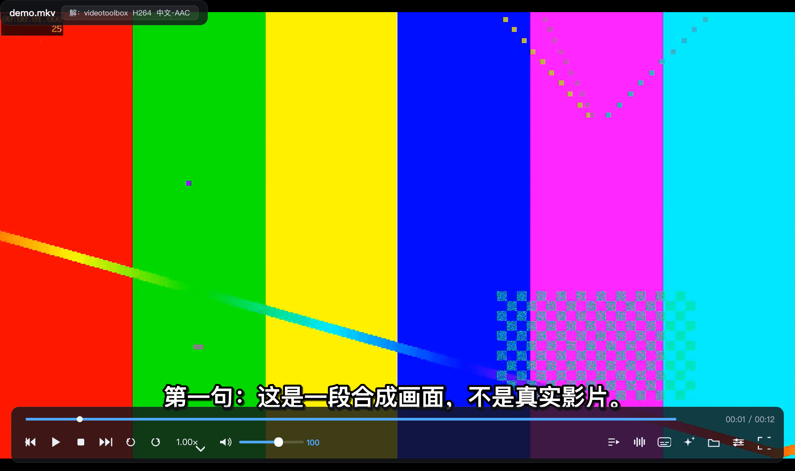
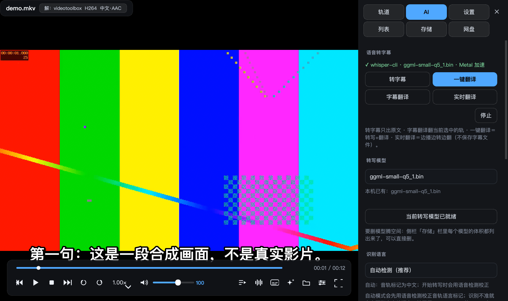
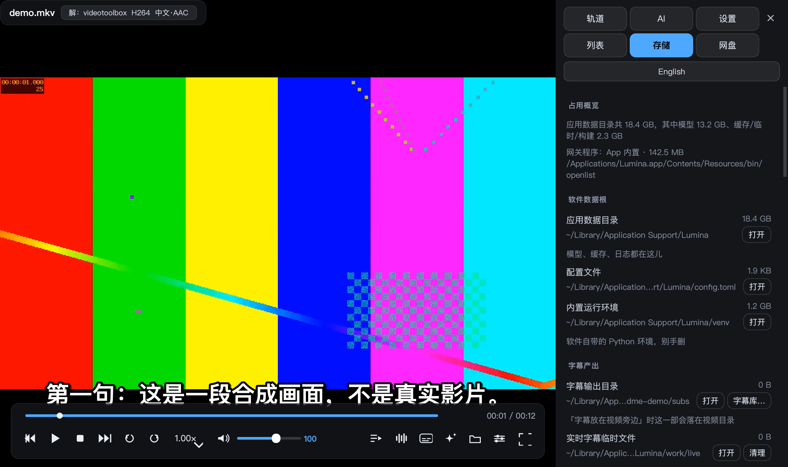
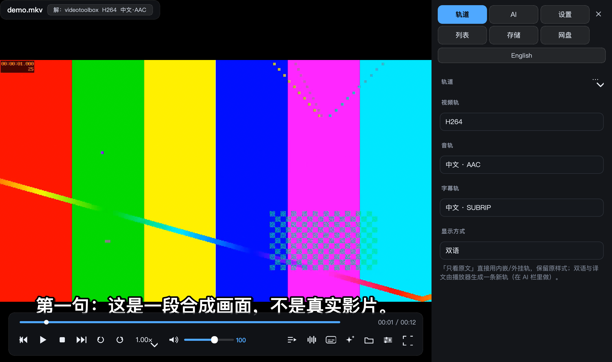
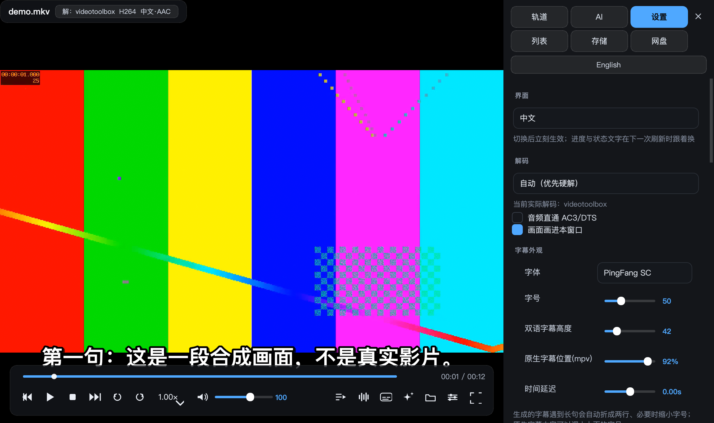
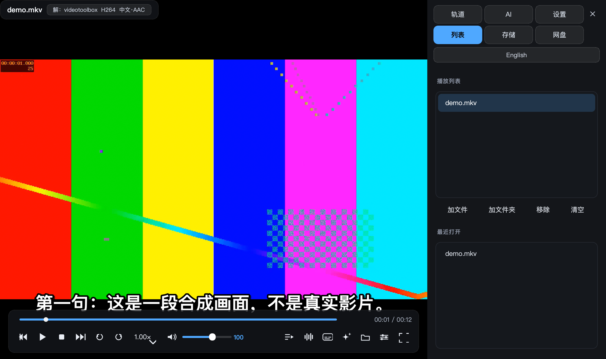
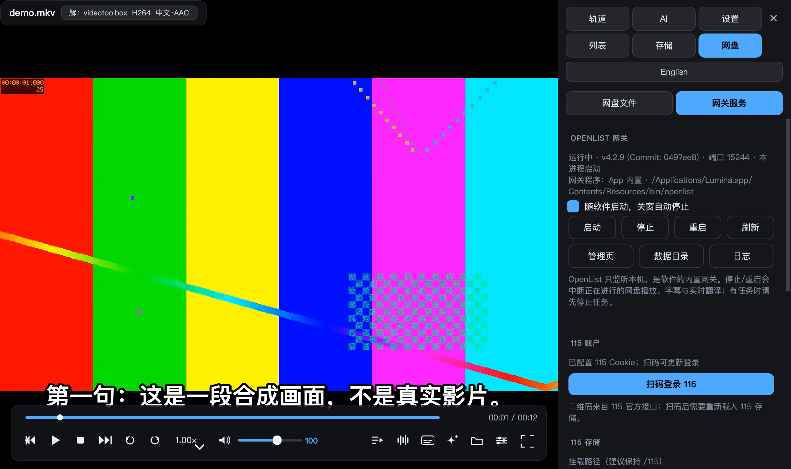

# Lumina Player

**中文** · [English](README.en.md)

一个 macOS 本地视频播放器：打开就能看，字幕自己认，外语片自己听出来再翻，片子放在 115 网盘里也能直接播。

<div align="center">


</div>



---

## 为什么写它

我想要的东西很具体，市面上的播放器又都给不全：

1. **打开片子不用管轨道** —— 音轨、字幕按我的语言偏好自动选好，之后每部片都不用重复点。
2. **没字幕的片子它自己听** —— 转写出来，再翻成中文，最好还能边播边翻。
3. **网盘里的片直接播** —— 不先下载、不挂盘、不留缓存文件在硬盘上。
4. **出问题不用回终端** —— 软件自己体检、自己补依赖，所有产物路径摊在明面上，我能自己清。

Lumina 不是 mpv 的皮肤：libmpv 以 in-process 方式画进自己的 GL 控件，外面是一层我自己用着顺手的交互。

---

## 界面

| AI 字幕面板 | 存储与清理 |
|---|---|
|  |  |

| 轨道与语言 | 播放设置 | 播放列表 |
|---|---|---|
|  |  |  |

侧栏六个标签：轨道 / AI / 设置 / 列表 / 存储 / 网盘。低频动作收在下拉里，不做成一屏按钮。
截图里的画面是 `scripts/make_shots.py` 用 ffmpeg 现造的合成测试片，不含任何真实影片。

---

## 播放

- **真·单窗口**：libmpv 通过 ctypes 在自己的 `QOpenGLWidget` 里渲染，不是"起个 mpv 子进程再把它贴上来"。硬解仍然走 VideoToolbox（标题栏会显示 `解：videotoolbox`），不是拿性能换外观。
- **解码可选**：`auto-safe`（优先硬解、失败自动回软解）/ 强制硬解 / 强制软解。
- **格式交给 FFmpeg**：mkv / mp4 / m2ts / rmvb / flv / webm / mxf / vob 等 60 多种后缀，音频含 mp3 / flac / ape / dsf / mka / tta 等。
- **Finder 集成**：双击、右键"打开方式"、拖到 Dock 图标都能进来；也支持命令行传文件或目录。
- **控制条**：逐帧、±10s / ±30s / ±60s、0.25 倍速步进、章节条、播放列表、断点续播、独立停止键。

## 字幕与语言

- **默认语言偏好**：按 BCP-47 标签顺序自动挑音轨与字幕轨（默认 中文 → 英文），一次设定长期生效；**你手动选过的轨永远优先**，不会被默认策略抢回去。
- **三态显示**：原文 / 双语 / 译文（`Z`）。双语是自己生成的一条 ASS —— 原文一行、译文一行，长句自动折行并按字号微缩，不会出画。
- **样式全可调**：字体、字号、描边、阴影、边距、延迟、粗体，以及 AI 字幕在原文上方还是下方。
- **原生字幕**：srt / ass / ssa / vtt / sub / idx / lrc 直接读，也能手动挂外部字幕。

## AI 字幕：转写 + 翻译

- **整片转写**：whisper.cpp，长片自动 10 分钟分段、3 秒重叠，边跑边出句子；片头音乐导致某段 0 句时自动从 +30 秒重试。
- **实时转写**：边播边转的滑动窗口（默认 20 秒窗、4 秒重叠），并预读播放头前方一段，让字幕尽量赶在画面前。
- **声道处理**：5.1 / 7.1 只取中置声道再识别 —— 整轨下混会被背景音乐盖住，whisper 会陷入复读。
- **语言不是猜一次**：先用语音检测在片头/多个位置采样校正音轨标签（日语标成 eng 的片子很常见），每部片单独记住结果；改语言后旧转写语言不一致时会重转，不会拿英文转写去"翻译"日文。
- **翻译后端四选一**：OpenAI 兼容接口（可填任意 base_url）/ DeepL / **本地 llama.cpp + GGUF（完全离线）** / Argos。
- **本地模型分工**：实时用小模型追速度（0.5B–3B），一键/整片用大模型慢慢翻（7B / Qwen3.5-9B / 14B）。下拉里选未下载的型号，按钮就变成下载，带断点续传与镜像回退。
- **懂上下文**：可选把前 N 句原文/译文喂给模型，人称和称呼不会前后乱跳。
- **不重复花钱**：翻过的句子进磁盘缓存，重看同一部片直接复用。
- **产物归位**：每部片一个文件夹，`<片名>.原文.srt` / `<片名>.<语言>译文.srt` / `<片名>.双语.ass` 三份，重开片子自动挂回上次生成的字幕。

## 115 网盘直连



- **网关已编译进 App**：OpenList（内含 115driver）由 `scripts/build_openlist.sh` 从源码构建，落在 `Lumina.app/Contents/Resources/bin/openlist`，只监听 `127.0.0.1`。**开软件它就起来，关软件它就收掉**，也可以改成手动启停 —— 不用你另外装任何东西。
- **播放地址永远不变**：Lumina 只认 loopback WebDAV，直链刷新交给网关；管理员 token 每次现读，不写进配置文件。
- **单流 Range 代理**：115 CDN 对同一文件的第二条并发流会 403，所以云端实时翻译只向上游开**一条**顺序连接，字节放进内存块缓存，播放器和转写都从本机这一份缓存取数。**视频不落盘**。
- **不互抢**：走代理时会把播放器的预读压到与缓存匹配的量，并按码率换算预读秒数 —— 否则两条读流会互相把上游拽走，触发限流保护。
- **扫码登录在软件里完成**，不用去网页后台。

## 透明与可维护

- **环境体检自愈**：缺 mpv / ffmpeg / whisper-cli 时直接在应用里调 Homebrew 装，能看输出、可取消。
- **存储台账**：每个产出、下载、缓存落在哪儿、占多大、能不能删，全在「存储」栏，按 *软件数据根 / 字幕产出 / 缓存与标记 / 网关与日志 / 构建与分发* 分类，每行都能"打开"进 Finder。**删除范围锁死在软件自己的数据目录内**，路径全部由代码算出，不写死常量。
- **模型可以删**：转写与翻译模型逐个列出体积、标出"正在被谁用"，删除要确认、有任务在跑时拒绝；删掉在用的模型会自动改用替补并同步界面。
- **崩溃可查**：应用日志、播放器日志、网关日志都有路径可点，异常都写文件（GUI 应用没有控制台）。
- **有判据**：`scripts/selfcheck.py` 281 项结构自检（含硬解、内嵌、代理、语言识别、存储与隐私），另有 6 套端到端验证套件。

---

## 下载与安装

去 [Releases](https://github.com/hahawsss/Lumina-Player/releases) 下载 `Lumina-0.1.0-macOS-arm64.zip`（约 188 MB，内含 Python 运行时、PySide6 与云盘网关），解压后把 `Lumina.app` 拖进「应用程序」。

> **第一次打开请右键 →「打开」**（没有 Apple 开发者签名与公证），或者：
> ```bash
> xattr -dr com.apple.quarantine /Applications/Lumina.app
> ```
> 播放还需要 Homebrew 的 `mpv` 与 `ffmpeg`；缺了会在应用内提示并直接帮你装。

### 源码运行

```bash
git clone https://github.com/hahawsss/Lumina-Player.git
cd Lumina-Player && ./start.sh            # 体检 → 建运行时 → 起播放器
./start.sh 影片.mkv                        # 直接播（可给多个文件或目录）
./start.sh --check                         # 只体检不启动
./run.sh 影片.mkv                          # 用 uv 环境直跑，参数透传
```

也可以双击仓库根目录的 **「启动 Lumina.command」**。

### 自己构建

```bash
./scripts/build_openlist.sh   # 从源码编译云盘网关（钉版本，产物进构建缓存）
./scripts/make_app.sh         # 本机自用 .app：装进 /Applications，含上面的网关
./scripts/make_portable.sh    # 可分发 .app + zip（自带 Python 运行时；出包前强制解包复检签名与源码一致性）
./scripts/verify_all.sh       # 六套验证 + 281 项自检
./scripts/make_shots.py       # 重新生成 README 截图（只用合成素材）
```

> 运行时 venv 必须建在 `~/Library/Application Support/Lumina/` 且用非可编辑安装：macOS 的 TCC 把「文稿」当受保护目录，launchd 拉起的 GUI 进程会卡在一个看不见的授权弹窗上。

---

## 快捷键

| 键 | 功能 | 键 | 功能 |
|---|---|---|---|
| `空格` / `K` | 播放·暂停 | `←` / `→` | −10s / +30s |
| `Shift+←/→` | ±60s | `Alt+←/→` | 上/下一个 |
| `↑` / `↓` | 音量 | `M` | 静音 |
| `[` / `]` | 速度 ±0.25 | `Backspace` | 恢复 1× |
| `,` / `.` | 逐帧 | `F` | 全屏 |
| `Z` | 原文 → 双语 → 译文 | `S` / `A` | 切字幕轨 / 切音轨 |
| `T` | AI 字幕 | `G` | 轨道 |
| `I` | 设置 | `L` | 播放列表 |
| `D` | 网盘（115 文件 / 网关服务） | `R` | 存储与清理 |
| `Ctrl+O` | 打开 | `Ctrl+S` | 加字幕文件 |
| `⌘,` | 设置 | `Ctrl+H` | 收侧栏 |

---

## 数据都在哪

全部在 `~/Library/Application Support/Lumina/`，卸载就是删掉这个目录：

| 路径 | 内容 | 能不能清 |
|---|---|---|
| `config.toml` | 配置，可直接编辑 | 保留 |
| `venv/` | 运行时 Python 环境 | 别手删 |
| `models/whisper/` | 转写模型（`ggml-*.bin`，默认 small 约 181 MB） | 可删，界面里删 |
| `models/llm/` | 本地翻译模型（`*.gguf`，0.46–9 GB） | 可删，界面里删 |
| `subtitles/` | 生成的字幕，每片一个文件夹 | 字幕库里手删 |
| `work/` | 转写用的临时音频、抽取的内嵌字幕 | 可清 |
| `work/live/` | 实时翻译的临时字幕，退出即清 | 可清 |
| `cache/` | 翻译缓存、转写标记、每片语言台账 | 可清（清了会重转/重翻） |
| `cloud/openlist/` | 网关数据目录：**115 登录状态与挂载配置在这里** | 保留（删了要重新扫码） |
| `build/` | 网关构建缓存（Go 工具链 + 源码 + module） | 可清，重编要重新下 |
| `app.log` / `lumina.log` | 应用日志 / 播放器日志 | 可清 |

---

## 隐私

- **没有任何遥测**：不统计、不上报、不检查更新，除了你主动用的翻译接口和网盘，软件不连任何服务器。
- **115 凭据只在本机**：cookie 存在 `cloud/openlist/data.db` 里，由本机网关持有；Lumina 每次现读管理员 token，**不写进配置文件、不上传**。
- **API 密钥只进 macOS 钥匙串**（或环境变量 `LUMINA_OPENAI_KEY` / `LUMINA_DEEPL_KEY`），配置文件里不会出现明文。
- **网盘视频不落盘**：只有转写用的临时音频会短暂落盘，用完即删，「存储」栏里能看见并清掉。
- **发布的包经过隐私闸门**：`make_portable.sh` 出包前会清掉字节码、构建路径等本机痕迹，并用真实凭据值逐字节比对包内文件，命中就不出包。

---

## 已知限制

- **开发中项目**：0.1.x，配置项与界面结构可能变。
- **未签名 / 未公证**：首次打开要右键 →「打开」。
- **只在 Apple Silicon 上实测**：Intel Mac 未验证；Windows / Linux 没有适配计划。
- **115 需要你自己授权**：首次要在「网盘 → OpenList 服务」里扫码；115 侧有请求频率限制，高码率长片的实时转写会受带宽影响。
- **实时翻译对模型大小敏感**：实时槽建议 ≤3B，9B/14B 留给整片或一键翻译。
- **AI 功能要额外下载**：whisper 模型约 75 MB–1.5 GB，本地翻译模型约 0.46–9 GB；在线翻译自备密钥。

---

## 授权

代码以 **GPL-3.0** 发布，全文见 [LICENSE](LICENSE)。

捆绑/依赖的第三方组件：

| 组件 | 授权 | 怎么给 |
|---|---|---|
| mpv（播放内核） | GPL-2.0+ | 由 Homebrew 提供，不随包分发 |
| FFmpeg | LGPL/GPL（按构建） | 由 Homebrew 提供 |
| whisper.cpp | MIT | 由 Homebrew 提供 |
| llama.cpp | MIT | 由 Homebrew 提供（可选） |
| **OpenList**（内含 115driver） | **AGPL-3.0** / MIT | **二进制随包分发**；版本、commit、构建参数与重编命令写在 `Lumina.app/Contents/Resources/openlist-build-info.txt`，构建脚本是本仓库的 `scripts/build_openlist.sh` |
| PySide6 / Qt | LGPL-3.0 | pip 依赖，动态链接 |
| 字体（PingFang SC 等） | 系统自带 | 不随包分发 |

## 免责

本项目用于播放**你自己合法拥有**的影音内容。软件不提供、不内置、不分发任何影视资源；网盘功能只是连接你自己的账号，请遵守所在地法律与网盘服务条款。

---

写给自己用的东西，顺手也放出来。要是你正好也需要这样一个播放器，欢迎试用、提 issue。
